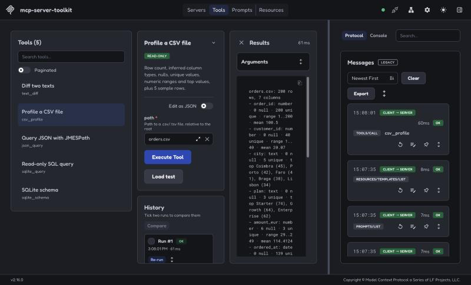
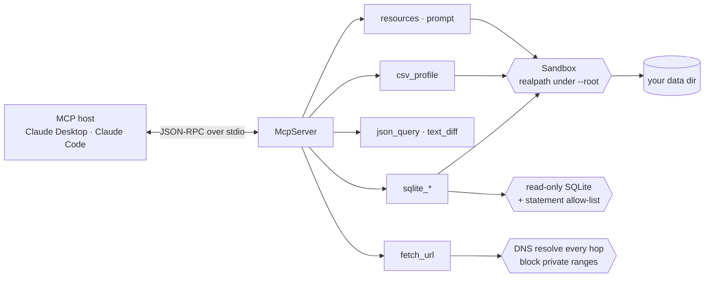

# mcp-server-toolkit

[](https://github.com/joaofrancowork/mcp-server-toolkit/actions/workflows/ci.yml)


A [Model Context Protocol](https://modelcontextprotocol.io) server that gives AI agents
(Claude Desktop, Claude Code, any MCP client) **data tools**: read-only SQL, CSV profiling,
JSON queries, web fetch and text diffs. It is built for the failure mode that matters with
agents: **a prompt-injected model calling your tools**. Every tool is sandboxed, read-only and
tested against the attacks.



## Tools

| Tool | What it does | Guardrails |
|---|---|---|
| `sqlite_schema` | Tables, columns and row counts of a SQLite file | Read-only connection |
| `sqlite_query` | One SQL query, results as a Markdown table plus structured rows | Read-only connection **and** a single `SELECT`/`WITH`/`EXPLAIN`; `ATTACH`, `PRAGMA` and writes rejected; 500-row cap |
| `csv_profile` | Row count, inferred types, nulls, uniques, ranges, top values, sample rows | Sandboxed path, 20 MB cap |
| `json_query` | JMESPath over a JSON document | Input size cap; parse and expression errors returned to the model |
| `text_diff` | Unified diff and word-level change counts | Input size cap |
| `fetch_url` | Public web page as readable text | **SSRF protection** on every hop, http(s) only, no credentials in URLs, 2 MB cap, 10 s timeout, max 3 redirects |

Plus a `toolkit://files` resource (what is available), a `toolkit://file/{path}` template, and
an `explore_dataset` prompt that makes the model profile before it queries and show its
evidence. All tools carry `readOnlyHint`; only `fetch_url` is `openWorldHint`.

## Quick start

Claude Desktop (`claude_desktop_config.json`) or any MCP host:

```json
{
  "mcpServers": {
    "data": {
      "command": "npx",
      "args": ["-y", "github:joaofrancowork/mcp-server-toolkit", "--root", "/path/to/your/data"]
    }
  }
}
```

Claude Code: `claude mcp add data -- npx -y github:joaofrancowork/mcp-server-toolkit --root ./data`

From source:

```bash
git clone https://github.com/joaofrancowork/mcp-server-toolkit && cd mcp-server-toolkit
npm ci && npm run build
npm run inspect          # MCP Inspector against the example data
```

Docker (stdio): `docker run -i --rm -v "$PWD/data:/data:ro" mcp-server-toolkit`.
Options: `--root <dir>` (or `MCP_TOOLKIT_ROOT`), `--no-fetch` to disable the only network tool.

## Architecture



## Security model

The model is not trusted: anything it reads (a web page, a CSV cell) may contain instructions
from an attacker. The tools assume that and limit the blast radius.

- **Filesystem.** Paths are resolved to their *real* path before the prefix check, so `../`,
  absolute paths and symlinks pointing outside `--root` are refused. Only expected extensions
  are opened.
- **SQL.** Two independent layers: SQLite opens the file with `readOnly: true`, and the query
  must be one `SELECT`/`WITH`/`EXPLAIN` without write, `ATTACH` or `PRAGMA` keywords (string
  literals are ignored, so `WHERE name = 'drop'` still works).
- **Network.** `fetch_url` resolves the host and rejects private, loopback, link-local, CGNAT,
  multicast and IPv4-mapped IPv6 addresses (cloud metadata at `169.254.169.254` included). It
  does this again for every redirect, which is how most SSRF filters are bypassed.
- **Errors are results.** Expected failures come back as `isError` tool results with a readable
  message, so the model can correct itself instead of the session crashing.
- **stdout is the protocol.** Logs go to stderr only.

## Testing

```bash
npm test         # 36 tests through a real MCP client over an in-memory transport, coverage gate
npm run smoke    # builds, spawns the server over stdio and calls a tool, as a host would
```

The tests cover the protocol surface (tools, resources, prompt), the behaviour of each tool and
the attacks: path traversal, symlink escape, SQL writes hidden in CTEs, multiple statements,
`ATTACH`, SSRF through private IPs, DNS answers that mix public and private addresses,
redirects to localhost, redirect loops and oversized responses.

CI runs lint (Biome), `tsc --strict`, tests on Node 22 and 24, the stdio smoke test, a Docker
build with an `initialize` handshake, and on a `v*` tag publishes a GitHub release with the
packed tarball.

## Roadmap

- [ ] Streamable HTTP transport with OAuth for remote deployments
- [ ] Parquet support via DuckDB (read-only)
- [ ] Per-tool rate limits and an audit log of tool calls
- [ ] `fetch_url` content extraction with Readability

## License

MIT. The example data is generated by `npm run examples` and is fictional.
